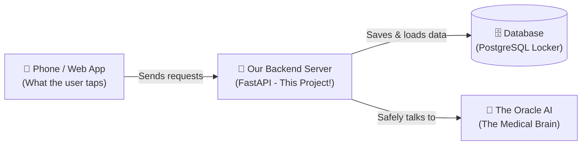
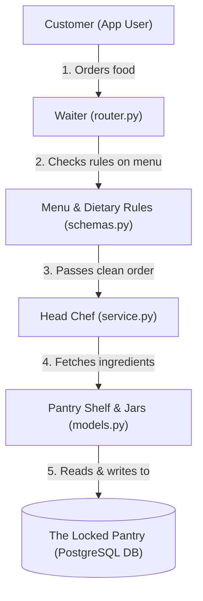
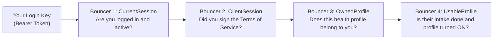
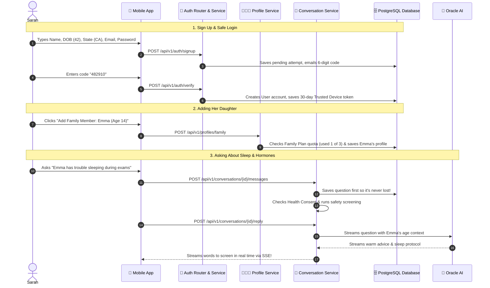
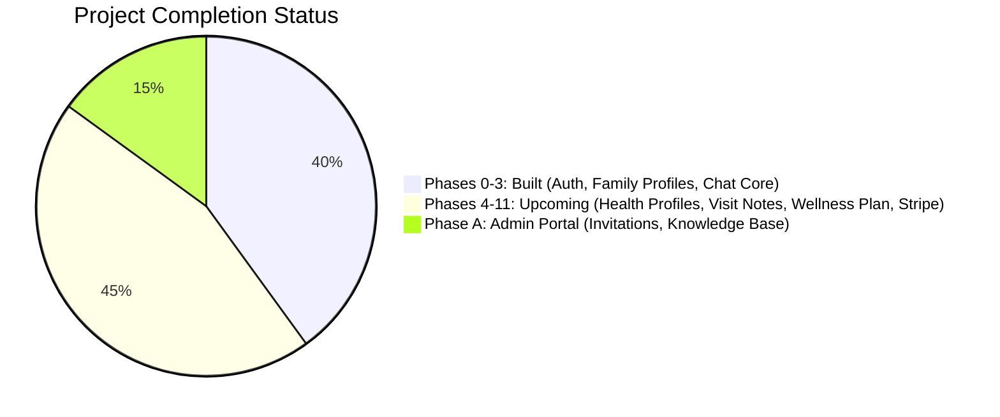

# Genesis Health: How Everything Works (Explained for Normal Humans!)

> **Welcome!** If you've ever looked at a software project and felt like you were staring at alien hieroglyphics, don't worry. This guide explains **every single piece** of our backend system in plain, simple English—the way you'd explain it to a 13-year-old.

---

## 1. The Big Idea: What Are We Actually Building?

Imagine having a super-smart, warm, and trustworthy health doctor in your pocket. That's **Genesis Health** (also called **"Your Oracle"**). 

It was designed by an expert nurse practitioner named **Deborah Maragopoulos**. It helps people—especially women and moms—understand their bodies, balance their hormones, prepare notes before going to a real doctor, and manage the health of their entire family (kids, teens, spouses).

To make this magic work in the real world, the system is split into three main pieces:



1. **The Frontend (The Face):** The React website or mobile app on your iPhone or laptop with buttons, forms, and chat screens.
2. **The Backend API (The Brain & Vault - *THIS PROJECT!*):** The engine room. It checks who you are, keeps your health data private, enforces rules, and talks to the database.
3. **The Database (The Locked Vault):** A secure storage system (PostgreSQL) that stores passwords, health answers, and chat messages safely.
4. **The Oracle AI (The Medical Expert):** The artificial intelligence that reads clinical books and answers patient questions with warm, accurate guidance.

---

## 2. The Restaurant Metaphor: How Every Folder Works

Inside our code, we organize everything using a simple 4-step system. Think of it like a **busy Italian restaurant**:



Every single feature folder (`auth`, `profiles`, `conversations`, `accounts`) uses these exact four files:

| File | What It Does (The Analogy) | Real Life Example |
| :--- | :--- | :--- |
| **`router.py`** | **The Waiter:** Stands at the door. Listens for web requests (like `/signup` or `/reply`), takes the order, and delivers the answer back. | Tells the app: *"Yes, here is your conversation!"* |
| **`schemas.py`** | **The Menu & Form Validator:** Makes sure you wrote a real date of birth, typed a real email, and didn't leave passwords blank. | Rejects your form if you forgot an `@` sign in your email. |
| **`service.py`** | **The Head Chef:** Does all the actual cooking and business thinking. Enforces rules, checks if you're an adult, and saves your data. | Calculates: *"Sarah already has 3 family members, she can't add a 4th without upgrading!"* |
| **`models.py`** | **The Pantry Labels:** Explains to the database how tables and columns should look (like naming shelves for `users`, `messages`, and `profiles`). | Defines that every user must have an ID, an email, and a password hash. |

---

## 3. The Security Bouncers: How Every Click is Checked

Before the server lets anyone see medical records or send a chat message, it passes them through a line of **security bouncers** (we call these **Dependencies**):



If someone tries to peek at someone else's child's profile, Bouncer 3 immediately blocks them with a **404 Not Found** so they can't even tell that the profile exists!

---

## 4. Complete File-by-File Guide (What Every File Does!)

Here is the master map of all 48 files in our project:

### 🌟 The Big Boss Files (Root `app/`)
* **[`app/main.py`](file:///c:/Users/mubashir.ali/Desktop/Genesis%20Health/Genesis-Health-Backend-API/app/main.py)**: The main front door of the server. It turns on FastAPI, sets up security rules (CORS), connects all the routers together under `/api/v1`, and turns on nice error messages.
* **[`app/models.py`](file:///c:/Users/mubashir.ali/Desktop/Genesis%20Health/Genesis-Health-Backend-API/app/models.py)**: The master phonebook of database tables. It imports all tables so our database tool (Alembic) knows what tables need to be created.
* **[`app/worker.py`](file:///c:/Users/mubashir.ali/Desktop/Genesis%20Health/Genesis-Health-Backend-API/app/worker.py)**: The night-shift robot. It runs in the background and cleans up tasks from the `jobs` table (like retrying a safety check if the internet flickered, or deleting unfinished sign-ups after 1 hour).

---

### 🧰 `app/core/` (The Shared Toolbox)
* **[`core/config.py`](file:///c:/Users/mubashir.ali/Desktop/Genesis%20Health/Genesis-Health-Backend-API/app/core/config.py)**: The master control dials. Holds settings like how long login codes last (10 minutes), trial length (14 days), and password rules. Reads from `.env`.
* **[`core/database.py`](file:///c:/Users/mubashir.ali/Desktop/Genesis%20Health/Genesis-Health-Backend-API/app/core/database.py)**: The cable that plugs our Python code into PostgreSQL. It gives each web request a fresh connection and closes it when done.
* **[`core/ages.py`](file:///c:/Users/mubashir.ali/Desktop/Genesis%20Health/Genesis-Health-Backend-API/app/core/ages.py)**: The age calculator. Calculates birthdays and checks if someone is 18+. Uses Hawaii time so nobody becomes an adult before their birthday actually starts at home!
* **[`core/security.py`](file:///c:/Users/mubashir.ali/Desktop/Genesis%20Health/Genesis-Health-Backend-API/app/auth/security.py)**: The code scrambler. Hashes passwords using **Argon2id** (military-grade password protection) so even if a hacker stole the database, they could never read your password.
* **[`core/audit.py`](file:///c:/Users/mubashir.ali/Desktop/Genesis%20Health/Genesis-Health-Backend-API/app/core/audit.py)**: The black-box flight recorder. Records every login, password change, and consent for legal compliance. The database physically forbids anyone from editing or deleting these logs!
* **[`core/email.py`](file:///c:/Users/mubashir.ali/Desktop/Genesis%20Health/Genesis-Health-Backend-API/app/core/email.py)**: The postman. Sends 6-digit verification codes and reset links. In development, it prints emails right in your terminal so you don't need a real email server.
* **[`core/errors.py`](file:///c:/Users/mubashir.ali/Desktop/Genesis%20Health/Genesis-Health-Backend-API/app/core/errors.py)**: The friendly translator. Turns complicated computer crashes into polite, helpful messages like *"Please enter a valid email address."*
* **[`core/jobs.py`](file:///c:/Users/mubashir.ali/Desktop/Genesis%20Health/Genesis-Health-Backend-API/app/core/jobs.py)**: The chore list manager. Drops background chores into the database for `worker.py` to pick up.
* **[`core/schemas.py`](file:///c:/Users/mubashir.ali/Desktop/Genesis%20Health/Genesis-Health-Backend-API/app/core/schemas.py)**: Common cleaning tools for text (like stripping accidental spaces from names).

---

### 🔐 `app/auth/` (The Security Gatehouse)
* **[`auth/router.py`](file:///c:/Users/mubashir.ali/Desktop/Genesis%20Health/Genesis-Health-Backend-API/app/auth/router.py)**: The endpoints for logging in, signing up, typing 6-digit verification codes, forgot password, and reset password.
* **[`auth/schemas.py`](file:///c:/Users/mubashir.ali/Desktop/Genesis%20Health/Genesis-Health-Backend-API/app/auth/schemas.py)**: The forms. Checks that sign-ups have valid US states, checks password strength, and validates verification codes.
* **[`auth/service.py`](file:///c:/Users/mubashir.ali/Desktop/Genesis%20Health/Genesis-Health-Backend-API/app/auth/service.py)**: The brain of security. Locks accounts if someone types the wrong password 3 times, checks 2FA codes, and issues 30-day "trusted device" tokens.
* **[`auth/models.py`](file:///c:/Users/mubashir.ali/Desktop/Genesis%20Health/Genesis-Health-Backend-API/app/auth/models.py)**: Database tables for `users`, `sessions`, `trusted_devices`, `pending_sign_ups`, and `verification_challenges`.
* **[`auth/dependencies.py`](file:///c:/Users/mubashir.ali/Desktop/Genesis%20Health/Genesis-Health-Backend-API/app/auth/dependencies.py)**: Inspects the incoming `Authorization: Bearer` token to confirm you are truly logged in.
* **[`auth/emails.py`](file:///c:/Users/mubashir.ali/Desktop/Genesis%20Health/Genesis-Health-Backend-API/app/auth/emails.py)**: Friendly email wording for your 6-digit verification code and reset password links.
* **[`auth/jobs.py`](file:///c:/Users/mubashir.ali/Desktop/Genesis%20Health/Genesis-Health-Backend-API/app/auth/jobs.py)**: Erases abandoned sign-up attempts after 1 hour so garbage doesn't pile up.

---

### 👤 `app/accounts/` (Your Account & Legal Rules)
* **[`accounts/router.py`](file:///c:/Users/mubashir.ali/Desktop/Genesis%20Health/Genesis-Health-Backend-API/app/accounts/router.py)**: Endpoints for `GET /me` (who am I?), `/me/password` (change password), `/policies/current` (view legal rules), `/me/entitlements` (what does my plan allow?), and `/me/next-step` (where should the app go next?).
* **[`accounts/schemas.py`](file:///c:/Users/mubashir.ali/Desktop/Genesis%20Health/Genesis-Health-Backend-API/app/accounts/schemas.py)**: Form shapes for accepting updated legal terms and changing passwords.
* **[`accounts/service.py`](file:///c:/Users/mubashir.ali/Desktop/Genesis%20Health/Genesis-Health-Backend-API/app/accounts/service.py)**: Handles password changing, records when you accepted new terms of service, and figures out your next screen.
* **[`accounts/models.py`](file:///c:/Users/mubashir.ali/Desktop/Genesis%20Health/Genesis-Health-Backend-API/app/accounts/models.py)**: Tables for `policy_versions` (Terms & Privacy updates), `policy_acceptances`, and `deletion_requests`.
* **[`accounts/dependencies.py`](file:///c:/Users/mubashir.ali/Desktop/Genesis%20Health/Genesis-Health-Backend-API/app/accounts/dependencies.py)**: Ensures nobody can access health features until they have agreed to the latest Terms of Service.

---

### 👨‍👩‍👧 `app/profiles/` (The Family Health Hub)
* **[`profiles/router.py`](file:///c:/Users/mubashir.ali/Desktop/Genesis%20Health/Genesis-Health-Backend-API/app/profiles/router.py)**: URLs to create your own health profile (`/profiles/self`), add a child/spouse (`/profiles/family`), answer intake questions, turn profiles on/off, and request deletion.
* **[`profiles/schemas.py`](file:///c:/Users/mubashir.ali/Desktop/Genesis%20Health/Genesis-Health-Backend-API/app/profiles/schemas.py)**: The official medical intake questions (sex at birth, gender identity, pronouns, medical advocate consent).
* **[`profiles/service.py`](file:///c:/Users/mubashir.ali/Desktop/Genesis%20Health/Genesis-Health-Backend-API/app/profiles/service.py)**: Enforces family plan limits (3 members included), saves intake answers step-by-step, and manages turning profiles on/off.
* **[`profiles/models.py`](file:///c:/Users/mubashir.ali/Desktop/Genesis%20Health/Genesis-Health-Backend-API/app/profiles/models.py)**: The `profiles` table holding name, relationship (Daughter, Husband, Self), birth date, sex at birth, and completion status.
* **[`profiles/dependencies.py`](file:///c:/Users/mubashir.ali/Desktop/Genesis%20Health/Genesis-Health-Backend-API/app/profiles/dependencies.py)**: Checks that the profile in the URL actually belongs to you and isn't turned off.

---

### 💬 `app/conversations/` (The Oracle Chat Room)
* **[`conversations/router.py`](file:///c:/Users/mubashir.ali/Desktop/Genesis%20Health/Genesis-Health-Backend-API/app/conversations/router.py)**: Endpoints to ask health questions, sign the Health Consent, get topic suggestions, stream replies via SSE, delete chats, and leave thumbs up/down feedback.
* **[`conversations/schemas.py`](file:///c:/Users/mubashir.ali/Desktop/Genesis%20Health/Genesis-Health-Backend-API/app/conversations/schemas.py)**: Defines what a message looks like, interactive UI cards (widgets), and feedback ratings.
* **[`conversations/service.py`](file:///c:/Users/mubashir.ali/Desktop/Genesis%20Health/Genesis-Health-Backend-API/app/conversations/service.py)**: The conversation coordinator. Saves your question first (so you never lose it if your Wi-Fi drops), checks medical safety, and streams the Oracle's answer letter-by-letter.
* **[`conversations/models.py`](file:///c:/Users/mubashir.ali/Desktop/Genesis%20Health/Genesis-Health-Backend-API/app/conversations/models.py)**: Tables for `conversations`, `messages`, `health_consents`, and `message_feedback`.
* **[`conversations/dependencies.py`](file:///c:/Users/mubashir.ali/Desktop/Genesis%20Health/Genesis-Health-Backend-API/app/conversations/dependencies.py)**: Guarantees you can only read your own chats.
* **[`conversations/starters.py`](file:///c:/Users/mubashir.ali/Desktop/Genesis%20Health/Genesis-Health-Backend-API/app/conversations/starters.py)**: Creates smart conversation ice-breakers based on whether you're asking for yourself or your child.
* **[`conversations/jobs.py`](file:///c:/Users/mubashir.ali/Desktop/Genesis%20Health/Genesis-Health-Backend-API/app/conversations/jobs.py)**: Runs emergency safety checks in the background (detecting red-flag medical emergencies).

---

### 🤖 `app/oracle/` (The AI Brain Connector)
* **[`oracle/contract.py`](file:///c:/Users/mubashir.ali/Desktop/Genesis%20Health/Genesis-Health-Backend-API/app/oracle/contract.py)**: The strict rulebook for talking to the AI. Dictates what health details the AI is allowed to see, keeping patient privacy airtight.
* **[`oracle/fake.py`](file:///c:/Users/mubashir.ali/Desktop/Genesis%20Health/Genesis-Health-Backend-API/app/oracle/fake.py)**: A stunt double! Generates realistic mock AI replies while we develop, so we can build and test everything offline without paying for real AI tokens.
* **[`oracle/dependencies.py`](file:///c:/Users/mubashir.ali/Desktop/Genesis%20Health/Genesis-Health-Backend-API/app/oracle/dependencies.py)**: Injects the Oracle service into chat routes.

---

### 💳 `app/billing/` (Subscriptions & Quotas)
* **[`billing/entitlements.py`](file:///c:/Users/mubashir.ali/Desktop/Genesis%20Health/Genesis-Health-Backend-API/app/billing/entitlements.py)**: The rule referee. Checks if you're on a 14-day Free Trial or Family Plan, and prevents adding more family members than your plan allows.

---

## 5. Walkthrough: What Happens When Sarah Uses the App?

Let's follow a real-life user named **Sarah (age 42)** to see how these files work together:



---

## 6. What Is Built vs. What Remains to Be Built?

Here is the quick scorecard of our journey:



### ✅ What We Built (33 Endpoints - 100% Complete & Tested)
1. **Foundation & Security (Phase 0 & 1):** Full signup with 3-step age verification, Argon2id passwords, 2FA email codes, and 30-day trusted devices.
2. **Family Profiles & Guided Intake (Phase 2 & R):** Managing Self and Family profiles with plan quotas, guided intake answers, profile turning on/off, and formal deletion requests.
3. **Ask the Oracle Chat (Phase 3):** Informed Health Consent gates, personalized conversation starters, Server-Sent Events (SSE) live streaming with interactive widgets, thread deletion, and thumbs up/down feedback.
4. **Compliance & Legal (Phases 1 & 12):** Dynamic Terms of Service version tracking and automatic routing.

### ⏳ What Remains (Our Next Adventures!)
1. **Phase 4: Health Profile:** Consolidated medical dashboard showing allergies, medications, and health history.
2. **Phase 5 & 6: Visit Notes & PDF Briefs:** Generating doctor-ready appointment summaries you can download as PDFs before seeing a physician.
3. **Phase 7: My Wellness Plan:** Action plans, personalized hormone balancing protocols, and lifestyle recommendations.
4. **Phase 8: Stripe Subscriptions:** Real credit card checkout for upgrading from Free Trial to Family Plan.
5. **Phase A: Admin & Clinician Portal:** Adopting the senior's admin invitation endpoints (`/api/v1/admin/invitations`) and Knowledge Base reader (`/api/v1/knowledge-base`) for internal support staff.

---

## 7. How to Run It Right Now!

Open your terminal and run these commands from the `Genesis-Health-Backend-API` folder:

```bash
docker compose up -d               # 1. Starts the database vault in Docker
uv sync                            # 2. Installs Python packages
uv run alembic upgrade head        # 3. Builds the database tables
uv run fastapi dev app/main.py     # 4. Starts the API server (Swagger UI at http://127.0.0.1:8000/docs)
uv run python -m app.worker        # 5. Starts the background robot (in a 2nd terminal)
uv run pytest                      # 6. Runs all automated tests to prove it works!
```
